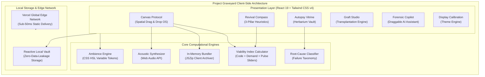

<div align="center">

# 🪦 Project Graveyard
### *The Forensic Archival, Code Salvage & Rebirth Engine for Modern Software Teams.*

**Transforming abandoned engineering repositories into fertile foundations for next-generation software.**

<br />

<!-- PRODUCTION CLOUD DEPLOYMENT CALLOUT -->
<table align="center" border="0" cellpadding="0" cellspacing="0">
  <tr>
    <td align="center" style="background: linear-gradient(135deg, #144227 0%, #0E332E 100%); padding: 20px 32px; border-radius: 16px; box-shadow: 0 12px 32px rgba(20, 66, 39, 0.28); border: 1px solid rgba(242, 189, 121, 0.4);">
      <h3 style="color: #F2BD79; margin: 0 0 10px 0; font-family: serif; font-size: 21px; letter-spacing: 0.5px;">
        ⚡ PRODUCTION DEPLOYMENT ACTIVE
      </h3>
      <a href="https://team-hashing-code-variant-ten.vercel.app/" target="_blank">
        
      </a>
      <p style="color: #E2E8F0; margin: 12px 0 0 0; font-size: 13px; font-family: sans-serif;">
        <strong>Live Production URL:</strong> <a href="https://team-hashing-code-variant-ten.vercel.app/" target="_blank" style="color: #6EE7B7; text-decoration: underline; font-weight: 600;">https://team-hashing-code-variant-ten.vercel.app/</a>
      </p>
    </td>
  </tr>
</table>

<br />

<!-- ENTERPRISE BADGES STRIP -->
[](https://team-hashing-code-variant-ten.vercel.app/)
[](https://github.com/anshjaiswal2911-tech/Team-Hashing-CodeVariant)
[](https://github.com/anshjaiswal2911-tech/Team-Hashing-CodeVariant)
<br />
[](https://react.dev/)
[](https://www.typescriptlang.org/)
[](https://tailwindcss.com/)
[](https://vitejs.dev/)
[](https://team-hashing-code-variant-ten.vercel.app/)
[](LICENSE)

<br />

**[🌐 Launch Console](https://team-hashing-code-variant-ten.vercel.app/)** &nbsp;&bull;&nbsp;
**[🖐️ The Canvas Protocol](#-the-canvas-protocol-spatial-developer-os)** &nbsp;&bull;&nbsp;
**[🔬 Forensic Autopsy](#1--forensic-autopsy--herbarium-vault)** &nbsp;&bull;&nbsp;
**[🎨 Display Calibration](#2--ambient-designer-themes--display-calibration)** &nbsp;&bull;&nbsp;
**[🤖 AI Copilot](#3--context-aware-ai-forensic-copilot)** &nbsp;&bull;&nbsp;
**[🧭 Viability Compass](#4--the-revival-compass--heuristic-decision-engine)** &nbsp;&bull;&nbsp;
**[📦 Salvage Yard](#5--salvage-yard--client-side-code-harvester)** &nbsp;&bull;&nbsp;
**[🏗️ Architecture](#-system-architecture--engineering-specifications)** &nbsp;&bull;&nbsp;
**[🚀 Quickstart](#-quickstart--local-setup)** &nbsp;&bull;&nbsp;
**[👥 Engineering Team](#-engineered-by-team-hashing)**

<br />

<a href="https://team-hashing-code-variant-ten.vercel.app/">
  
</a>

<p align="center">
  <sub><strong>Figure 1.0:</strong> Production Overview — The <em>Canvas Protocol</em> spatial tri-column workspace featuring real-time diagnostic dropzones, forensic telemetry, and multi-gate action execution.</sub>
</p>

</div>

---

## ⚡ Executive Summary: The Graveyard-to-Greenhouse Paradigm

In modern software engineering, **over 90% of internal prototypes, exploratory side-projects, and skunkworks experiments stall or cease active development**. Engineering organizations and solo builders routinely abandon these repositories due to shifting priorities, context decay, or scope creep. Yet within these dormant codebases lies substantial intellectual property:

- ✅ **Battle-Hardened Modular Assets**: Tested auth workflows, custom React hooks, database migrations, Stripe connectors, and clean UI components.
- ✅ **Unvalidated Product Timing**: Ideas that failed previously due to market unreadiness, but whose technological or market prerequisites now exist.
- ✅ **Critical Failure Pattern Intelligence**: Post-mortem telemetry detailing exact failure vectors (*Over-Engineering, Vendor Lock-In, Framework Churn, Solo Isolation*).

**Project Graveyard** eliminates code abandonment guilt by treating dormant repositories as **fertile technological compost**. It provides a dignified archival workflow, performs deep forensic autopsies, isolates reusable micro-modules with browser-native extraction, and cross-pollinates tested assets into new production projects via an intuitive **Graft Studio**.

> *"When a tree falls in the forest, its heartwood nourishes saplings for decades. Software should follow the same biological law: never discard what has already been perfected."*

---

## 🌟 Visual Showcase & Production Interface

<table width="100%">
<tr>
<td width="50%" valign="top">
<h3 align="center">🖐️ The Canvas Protocol (Spatial OS)</h3>
<a href="https://team-hashing-code-variant-ten.vercel.app/">
  
</a>
<p align="center"><sub><strong>Figure 2.1:</strong> Spatial tri-column drag-and-drop workspace: Drag dormant code from the catalog into diagnostic dropzones and dispatch directly into execution gates.</sub></p>
</td>
<td width="50%" valign="top">
<h3 align="center">🤖 Autonomous AI Forensic Copilot</h3>
<a href="https://team-hashing-code-variant-ten.vercel.app/">
  
</a>
<p align="center"><sub><strong>Figure 2.2:</strong> Draggable, floating conversational intelligence agent auditing commit histories, identifying salvageable code blocks, and advising refactoring paths.</sub></p>
</td>
</tr>
<tr>
<td width="50%" valign="top">
<h3 align="center">🧭 Revival Compass Viability Engine</h3>
<a href="https://team-hashing-code-variant-ten.vercel.app/">
  
</a>
<p align="center"><sub><strong>Figure 2.3:</strong> Multi-dimensional viability assessment: 3 core health signals, real-time developer momentum sliders, and algorithmic MVP sprint roadmaps.</sub></p>
</td>
<td width="50%" valign="top">
<h3 align="center">🪦 Herbarium Vitrine & Archival Ledger</h3>
<a href="https://team-hashing-code-variant-ten.vercel.app/">
  
</a>
<p align="center"><sub><strong>Figure 2.4:</strong> Museum-grade specimen vitrines cataloging architectural autopsy cards, death cause tags, and legal open-source reusability seals.</sub></p>
</td>
</tr>
</table>

---

## 🖐️ The Canvas Protocol: Spatial Developer OS

The **Canvas Protocol (`Drag. Drop. Revive.`)** replaces traditional flat CRUD dashboards with a spatial, tactile operating environment engineered for rapid triage:

```
┌─────────────────────────┐     ┌─────────────────────────┐     ┌─────────────────────────┐
│     PROJECT CATALOG     │ ──► │   DIAGNOSTIC DROPZONE   │ ──► │     EXECUTION GATES     │
│   • Dormant Specimen    │     │   • Viability Index     │     │   🚀 Deploy 120m Sprint │
│   • Dormancy Badges     │     │   • Root-Cause Autopsy  │     │   🔬 Deep Autopsy Folio │
│   • Reusability Scores  │     │   • Extracted Modules   │     │   📦 Archive Herbarium  │
│   • Real-Time Search    │     │   • Real-time Telemetry │     │   🗑️ Safe Expunction    │
└─────────────────────────┘     └─────────────────────────┘     └─────────────────────────┘
```

### Technical Workflow Highlights:
1. **Catalog Deck (Left Column)**:
   - High-density visual cards with dormancy age tags (`3 mos`, `6 mos`, `2 yrs`), completion metrics, and reusability badges.
   - Smooth pointer grab with physical elevation and dynamic shadow rendering.
2. **Diagnostic Staging Dropzone (Center Stage)**:
   - Dropping any project card immediately activates an automated architectural autopsy.
   - Computes completion percentage, flags technical debt, determines primary cause of demise, and previews harvestable component packages.
3. **Action Execution Gates (Right Column)**:
   - **Deploy Gate**: Automatically scaffolds a prioritized 120-minute MVP revival sprint with aggressive scope pruning.
   - **Submit Gate**: Triggers comprehensive code dissection and issues a certified digital folio and Reincarnation Will.
   - **Archive Gate**: Safely seals the project into the botanical herbarium vault with legal clearance tags.
   - **Delete Gate**: Verified, non-destructive removal with confirmation safeguards.
4. **Synthesized Acoustic Feedback (Web Audio API)**:
   - Micro-auditory feedback synthesized natively in-browser on card pick-up, drop events, and stage transitions without external audio assets.

---

## 🔬 Core Platform Architecture

### 1. 🪦 Forensic Autopsy & Herbarium Vault
- **Taxonomic Cause Classification**: Automated categorization into standardized failure modes (*Circumstantial Scope Creep, Technical Debt Saturation, Market Evaporation, Framework Fatigue, Solo Isolation*).
- **Herbarium Specimen Sheets**: Assigns museum-grade catalog folio records (e.g. `LL-02`, `EV-01`), architectural diagrams, and developer post-mortems.
- **Reincarnation Will & Legal Clearance**: Evaluates OSS licensing compatibility (MIT, Apache 2.0, BSD) ensuring extracted modules can be legally grafted into proprietary or new open-source codebases.

### 2. 🎨 Ambient Designer Themes & Display Calibration
- **5 High-Precision Curated Themes**:
  - 🌿 **Botanical Ivory (Pitch Deck Edition)**: Warm ivory canvas with deep pine typography.
  - 🧊 **Neo-Tactile Soft UI (Pivora Kit)**: Calm sand textures with sunken wells and raised cream tactile surfaces.
  - 🌌 **Galactic Glass (Dark Glassmorphism)**: Smoky emerald glass over an obsidian deep void.
  - 🌙 **Botanical Dark (Original Conservatory)**: Midnight forest depths with sage accents.
  - ☀️ **Monochrome SaaS (Enterprise Minimal)**: High-contrast luxury black and white.
- **Hardware Display Calibration**: Real-time interactive controls for **Brightness**, **Contrast**, **Transparency**, and **Accent Tone** persisted across sessions via reactive local state.

### 3. 🤖 Context-Aware AI Forensic Copilot
- **Free-Floating, Cursor-Movable Interface**: Non-obtrusive assistant widget that can be positioned anywhere across multi-monitor setups.
- **Smart Dormancy Detection**: Contextually alerts developers when dormant code reaches critical milestones (e.g., 90+ days without commit).

### 4. 🧭 The Revival Compass & Heuristic Decision Engine
- **3-Pillar Clarity Model**:
  1. 💻 **Code & Architecture Viability**: Volume of clean schemas, tested endpoints, and modular UI.
  2. 💡 **Market & Problem Urgency**: Validates whether user pain points remain relevant today.
  3. ⏱️ **Effort-to-Ship**: Concrete, actionable MVP sprint blueprints (*Prune non-essentials &rarr; Update API secrets &rarr; Ship 1-core-feature MVP*).
- **Dynamic Developer Pulse Sliders**: Interactive calibration for real-time recalculation of revival feasibility:
  - *Current Personal Excitement (0–100%)*
  - *Skill Growth Since Burial (0–100%)*
  - *Team vs. Solo Operational Bandwidth*
- **5 Actionable Archetype Verdicts**:
  - `Restart from Scratch` (Score &lt; 45)
  - `Continue with a Smaller Scope` (Score 75–90)
  - `Pivot Core Architecture` (Score 60–74)
  - `Repurpose Component Gems Only` (Score 45–59)
  - `Honor & Archive in Deep Soil` (Score &lt; 35)

### 5. 📦 Salvage Yard & Client-Side Code Harvester
- **Zero-Latency In-Browser Bundling**: Powered by `JSZip`, the platform extracts modular components and compiles a complete, organized `.zip` distribution archive entirely inside the client’s browser.
- **Production Asset Manifest**: Each exported bundle includes a structured `manifest.json`, component documentation, and clean directory structure ready for immediate `npm install` or local inclusion.

### 6. 🌱 Graft Studio: Cross-Repository Module Transplantation
- **Transplantation Matrix**: Synthesizes harvested components into modern starter frameworks (Next.js, Vite React, Remix, SvelteKit).
- **Dependency Compatibility Checker**: Scans runtime version mismatches before grafting code into destination repositories.

### 7. 📊 Pattern Insights: Post-Mortem Engineering Analytics
- **Macro Engineering Retrospective**: Aggregates behavioral analytics across your entire portfolio of projects.
- **Systemic Failure Diagnostics**: Visual charts revealing repeated anti-patterns so engineering teams avoid recurring bottlenecks in subsequent initiatives.

---

## 🏗️ System Architecture & Engineering Specifications

Project Graveyard is engineered on a **100% Local-First, Zero-Cloud Lock-In architecture**. All computations, viability heuristics, telemetry parsing, and zip archive generation occur locally within the client execution environment:



---

## 💻 Tech Stack & Production Standards

| Layer | Technology | Production Rationale |
| :--- | :--- | :--- |
| **Frontend Framework** | **React 19** | Modern React architecture leveraging automated compiler optimizations, concurrent rendering, and clean hook abstractions. |
| **Language** | **TypeScript Strict** | 100% strict type safety across specimen schemas, salvage manifests, and viability telemetry (`tsc --noEmit` clean). |
| **Styling & Design Tokens** | **Tailwind CSS v4** | Next-generation zero-runtime engine with CSS variables, fluid responsive layouts, and claymorphic soft-UI utilities. |
| **Bundling & Build Pipeline** | **Vite 8** | Sub-500ms production builds, native ESM path resolution, and instant Hot Module Replacement (HMR). |
| **Deployment & Edge Delivery** | **Vercel** | Global edge CDN distribution with client-side SPA routing rewrites configured via `vercel.json`. |
| **In-Browser Archiver** | **JSZip** | Compiles valid ZIP directory hierarchies directly in browser memory without server-side processing. |
| **Acoustic Feedback** | **Web Audio API** | Real-time parametric oscillator generating subtle haptic audio cues with zero external MP3/WAV dependencies. |
| **Iconography** | **Lucide React + Material Symbols** | Scalable, accessible SVGs maintaining architectural and botanical consistency. |

---

## ⌨️ Power-User Keyboard Shortcuts

For keyboard-first engineers and power users, Project Graveyard includes a full command-bar suite:

| Key Combination | Action | Operational Scope |
| :---: | :--- | :--- |
| <kbd>Cmd</kbd> + <kbd>K</kbd> / <kbd>Ctrl</kbd> + <kbd>K</kbd> | Open Global Command Palette & Specimen Search | App-wide |
| <kbd>J</kbd> | Quick-Jump to Workspace Modules | Workspace |
| <kbd>N</kbd> or <kbd>B</kbd> | Launch "Bury a Project / Add Specimen" Modal | Workspace |
| <kbd>?</kbd> | Display Interactive Keyboard Shortcuts Guide | App-wide |
| <kbd>Esc</kbd> | Dismiss any active modal, drawer, or dropdown menu | Global |
| <kbd>Enter</kbd> / <kbd>Shift + Enter</kbd> | Send Copilot message / Insert multiline code snippet | AI Copilot |

---

## 🚀 Quickstart & Local Setup

### System Prerequisites
- **Node.js**: `v20.x` or newer (Fully verified on `v22.22.1` LTS and `v24.x`).
- **npm**: `v10.x` or newer, Git.

### 1. Clone & Install

```bash
# Clone the repository
git clone https://github.com/anshjaiswal2911-tech/Team-Hashing-CodeVariant.git
cd Team-Hashing-CodeVariant

# Install dependencies with lockfile synchronization
npm install

# Start local high-performance development server
npm run dev
```

Visit **`http://localhost:3000`** (or the port specified in your terminal output).

### 2. Production Build Verification

```bash
# Run strict TypeScript static typecheck (0 errors required)
npm run lint

# Generate production bundle in dist/
npm run build

# Preview optimized production bundle locally
npm run preview
```

---

## 🌐 Production Deployment Architecture

- **🚀 Live Application URL**: [https://team-hashing-code-variant-ten.vercel.app/](https://team-hashing-code-variant-ten.vercel.app/)
- **📂 GitHub Source Repository**: [https://github.com/anshjaiswal2911-tech/Team-Hashing-CodeVariant](https://github.com/anshjaiswal2911-tech/Team-Hashing-CodeVariant)
- **⚙️ Edge Routing Configuration**: Powered by [`vercel.json`](vercel.json) ensuring seamless client-side single page routing across all URLs and sub-views.
- **⚡ Dependency Configuration**: Configured with [`.npmrc`](.npmrc) (`legacy-peer-deps=true`) for reproducible zero-conflict continuous integration and deployment.

---

## 👥 Engineered by Team Hashing

Crafted with dedication by **Team Hashing** to elevate software salvage and architectural preservation across the engineering industry:

<div align="center">

| Engineer | Focus & Core Contributions | GitHub Profile |
| :--- | :--- | :---: |
| **Ansh Jaiswal** | **Lead Architect & Frontend Systems** | [@anshjaiswal2911-tech](https://github.com/anshjaiswal2911-tech) |
| **Aryan Jaiswal** | **Software Developer & UI/UX Design Systems** | [@AryanJaiswalDev](https://github.com/AryanJaiswalDev) |
| **Mitesh Jha** | **The Canvas Protocol & Spatial Drag-and-Drop OS** | [@jhamitesh0302-afk](https://github.com/jhamitesh0302-afk) |
| **Rajiv Jha** | **Forensics Methodology & Data Schemas** | [@jharajiv315](https://github.com/jharajiv315) |

<br />

<p align="center">
  <sub>Project Graveyard &copy; 2026 Team Hashing. Released under the open-source MIT License.</sub>
</p>

</div>
