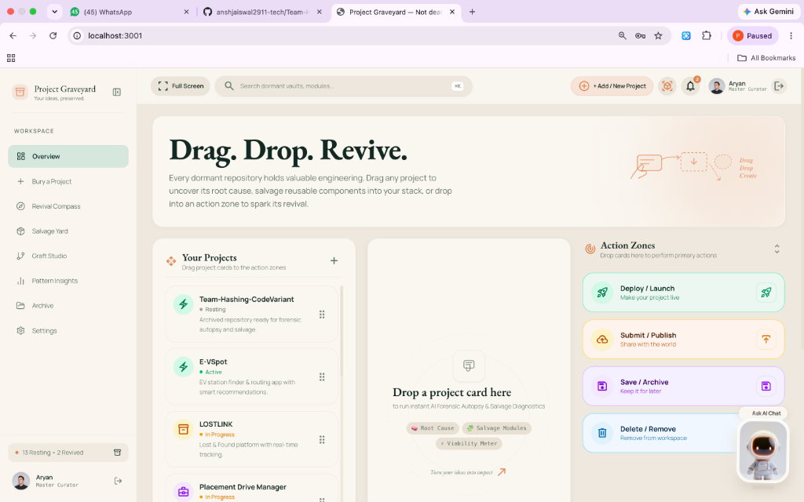
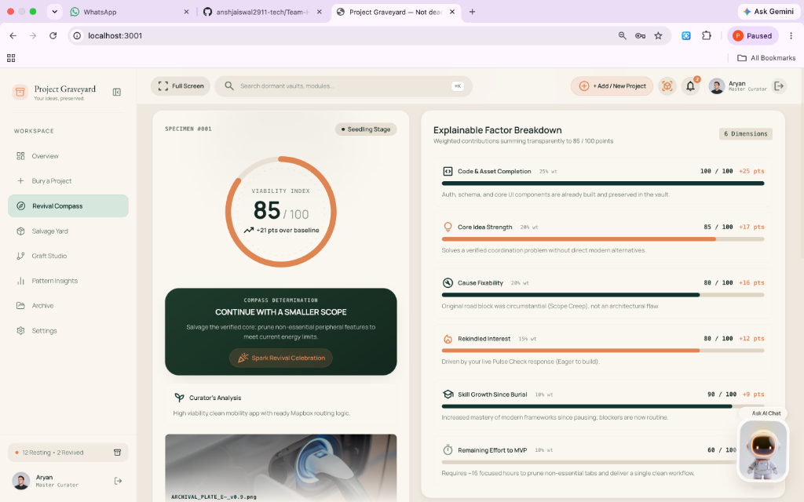
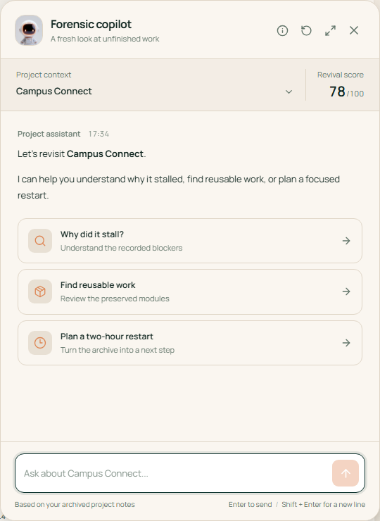
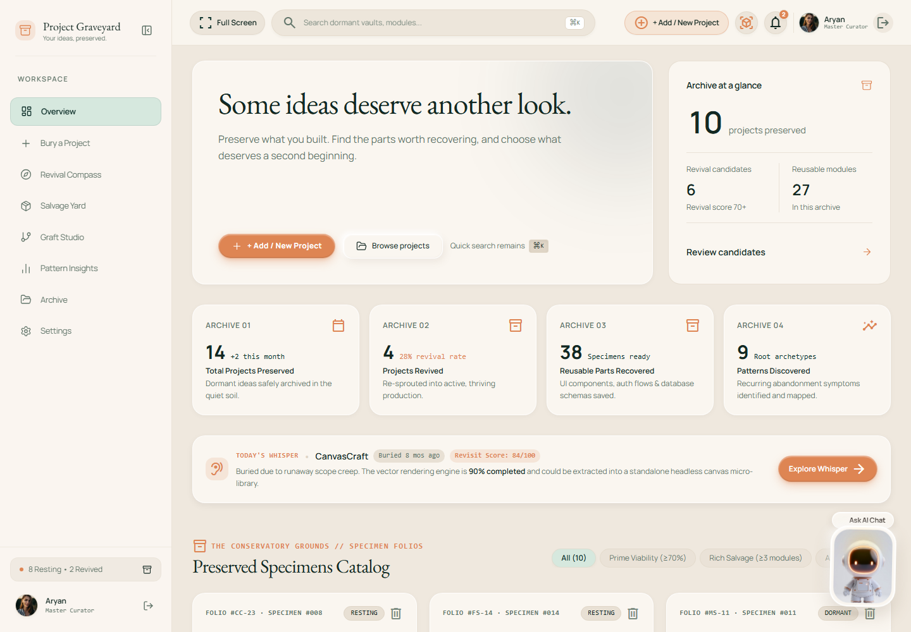
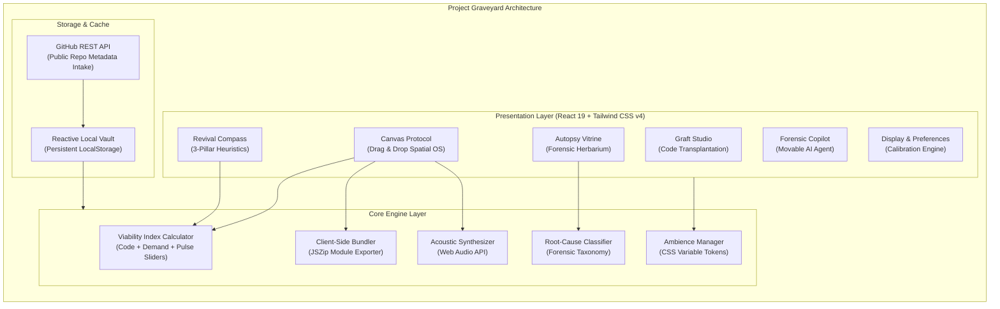

<div align="center">

# 🪦 Project Graveyard
### *Where Dead Projects Become Fertile Ground.*

**A Dignified Archival, Forensic Autopsy & Code Rebirth Engine for Modern Developers.**

<br />

<!-- LIVE DEMO SHOWCASE CALLOUT -->
<table align="center" border="0" cellpadding="0" cellspacing="0">
  <tr>
    <td align="center" style="background: linear-gradient(135deg, #144227 0%, #0E332E 100%); padding: 18px 28px; border-radius: 16px; box-shadow: 0 10px 30px rgba(20, 66, 39, 0.25); border: 1px solid rgba(242, 189, 121, 0.35);">
      <h3 style="color: #F2BD79; margin: 0 0 10px 0; font-family: serif; font-size: 20px; letter-spacing: 0.5px;">
        ✨ LIVE PRODUCTION DEMO
      </h3>
      <a href="https://team-hashing-code-variant-ten.vercel.app/" target="_blank">
        
      </a>
      <p style="color: #E2E8F0; margin: 10px 0 0 0; font-size: 13px; font-family: sans-serif;">
        <strong>Direct URL:</strong> <a href="https://team-hashing-code-variant-ten.vercel.app/" target="_blank" style="color: #6EE7B7; text-decoration: underline;">https://team-hashing-code-variant-ten.vercel.app/</a>
      </p>
    </td>
  </tr>
</table>

<br />

<!-- BADGES STRIP -->
[](https://team-hashing-code-variant-ten.vercel.app/)
[](https://github.com/anshjaiswal2911-tech/Team-Hashing-CodeVariant)
[](https://github.com/anshjaiswal2911-tech/Team-Hashing-CodeVariant)
[](https://github.com/anshjaiswal2911-tech/Team-Hashing-CodeVariant)
<br />
[](https://react.dev/)
[](https://www.typescriptlang.org/)
[](https://tailwindcss.com/)
[](https://vitejs.dev/)
[](https://team-hashing-code-variant-ten.vercel.app/)
[](LICENSE)

<br />

**[🌐 Launch Live App](https://team-hashing-code-variant-ten.vercel.app/)** &nbsp;&bull;&nbsp;
**[🖐️ The Canvas Protocol](#-round-2-surprise-challenge-the-canvas-protocol-option-a)** &nbsp;&bull;&nbsp;
**[🧭 Core Capabilities](#-core-capabilities)** &nbsp;&bull;&nbsp;
**[🏗️ Architecture](#-system-architecture)** &nbsp;&bull;&nbsp;
**[🏆 Rubric Matrix](#-hackathon-evaluation-rubric--deliverables-matrix)** &nbsp;&bull;&nbsp;
**[🚀 Quickstart](#-quickstart-guide)** &nbsp;&bull;&nbsp;
**[👥 Team Hashing](#-built-with-pride-by-team-hashing)**

<br />

<a href="https://team-hashing-code-variant-ten.vercel.app/">
  
</a>

<p align="center">
  <sub><strong>Figure 1.0:</strong> The <em>Canvas Protocol</em> in action on production — Spatial tri-column drag-and-drop workspace with autonomous dropzone forensics and instant action execution gates.</sub>
</p>

</div>

---

## ⚡ Executive Summary: The Graveyard-to-Greenhouse Paradigm

Over **90% of software side projects die silently** in abandoned local directories and private GitHub repositories. Developers walk away with lingering guilt, lost momentum, and context decay. Yet inside those neglected codebases lie:
- ✅ **Tested, battle-hardened code gems** (*Custom auth mechanisms, Prisma schemas, Stripe webhooks, responsive UI kits, API wrappers*).
- ✅ **Unvalidated product ideas** whose market timing may finally have arrived today.
- ✅ **Invaluable technical insights** that go unrecorded, causing engineers to repeatedly stumble on the same pitfalls (*Scope Creep, Framework Churn, Solo Isolation*).

**Project Graveyard** transforms this digital cemetery into a **fertile innovation greenhouse**. Rather than letting code rot in digital obscurity, it grants repositories a **dignified burial**, extracts their reusable genetic material, computes a transparent **Revival Viability Index**, and cross-pollinates salvageable assets into fresh applications via our proprietary **Graft Studio**.

> *"When a tree falls in the forest, its heartwood nourishes saplings for decades. We don't just mourn dead code — we harvest its seeds to birth the next generation of software."*

---

## 🌟 Visual Showcase & Live Screen Tours

<table width="100%">
<tr>
<td width="50%" valign="top">
<h3 align="center">🧭 Revival Compass Diagnostic</h3>
<a href="https://team-hashing-code-variant-ten.vercel.app/">
  
</a>
<p align="center"><sub><strong>Figure 2.1:</strong> Multi-dimensional viability assessment: 3 core health signals, real-time developer pulse calibration sliders, and actionable 120-minute MVP sprint blueprints.</sub></p>
</td>
<td width="50%" valign="top">
<h3 align="center">🤖 Context-Aware AI Forensic Copilot</h3>
<a href="https://team-hashing-code-variant-ten.vercel.app/">
  
</a>
<p align="center"><sub><strong>Figure 2.2:</strong> Draggable, floating autonomous forensic copilot diagnosing commit histories, extracting reusable components, and advising next sprint actions.</sub></p>
</td>
</tr>
<tr>
<td width="50%" valign="top">
<h3 align="center">🪦 Dignified Herbarium Vault</h3>
<a href="https://team-hashing-code-variant-ten.vercel.app/">
  
</a>
<p align="center"><sub><strong>Figure 2.3:</strong> Museum-grade specimen vitrines cataloging architectural autopsy cards, death cause tags, and legal open-source reusability seals.</sub></p>
</td>
<td width="50%" valign="top">
<h3 align="center">🖐️ The Canvas Protocol (Option A)</h3>
<a href="https://team-hashing-code-variant-ten.vercel.app/">
  
</a>
<p align="center"><sub><strong>Figure 2.4:</strong> Spatial triage: Drag catalog specimens into the center forensic autopsy dropzone, then dispatch directly into execution gates.</sub></p>
</td>
</tr>
</table>

---

## 🔥 Round 2 Surprise Challenge: The Canvas Protocol (Option A)

> ### 🏆 Challenge Option A Selected & 100% Implemented
> During the **Round 2 Surprise Challenge**, Team Hashing engineered **Option A: The Canvas Protocol (`Drag. Drop. Revive.`)** — replacing static CRUD tables and form wizards with an interactive, fluid spatial operating system:

| Canvas Layer | Technical Implementation | User Experience Impact |
| :--- | :--- | :--- |
| **1. Catalog Column (Left)** | Real-time filtered specimen list with dormancy badges, category tags, and viability score previews. | Drag any card smoothly with tactile shadow elevation. |
| **2. Diagnostic Dropzone (Center)** | Autonomous staging dropzone with auto-centering alignment, forensic telemetry, and completion analysis. | Dropping any card immediately reveals completion percentage, primary cause of demise, and salvageable gems. |
| **3. Action Execution Gates (Right)** | 4 distinct drop targets: **Deploy** (120-min sprint), **Submit** (deep autopsy), **Save** (archive vault), and **Delete** (safe removal). | Direct physical dispatch of codebases into real operational workflows without manual button clicks. |
| **4. Tactile Audio Feedback** | Built-in synthesizer utilizing the browser **Web Audio API**. | Subtle acoustic click and chime on card pick-up, drop, and successful triage. |

---

## 🎯 Core Capabilities

### 1. 🖐️ The Canvas Protocol (`Drag. Drop. Revive.`)
- **Spatial Tri-Column Workbench**: Replaces static dashboards with an interactive tactile canvas.
- **Drag-to-Diagnose**: Drag any project card from the left catalog and drop it into the central **AI Forensic Dropzone** to immediately compute its completion percentage, salvage potential, and cause of demise.
- **Instant Action Zones**: Drop staged specimens directly into right-side execution gates:
  - 🚀 **Deploy / Launch**: Launches a 120-minute revival sprint with focused scope pruning.
  - 🔬 **Submit / Publish**: Commences an in-depth forensic autopsy and issues a shareable digital folio.
  - 📦 **Save / Archive**: Preserves the specimen with honors in the Botanical Herbarium Vault.
  - 🗑️ **Delete / Remove**: Clean removal with safety guards.

### 2. 🪦 Dignified Burial Ceremony & Forensic Autopsy
- **Root-Cause Classification**: Automatically diagnoses why the project paused (*Circumstantial Scope Creep, Technical Debt, Lost Momentum, Solo Isolation*).
- **Herbarium Specimen Sheets**: Assigns museum-grade catalog folio numbers (e.g. `LL-02`, `EV-01`), botanical plates, and heartfelt developer epitaphs.
- **Reincarnation Will & Legal Clearance**: Generates certified export documentation and legal license verification ensuring salvaged components can be safely reused.

### 3. 🧭 Revival Compass & Viability Index
- **3-Pillar High-Clarity Verdict**:
  1. 💻 **Code & Reusable Assets Built**: Preserved schema, auth, and tested UI.
  2. 💡 **Problem Relevance & Market Demand**: Verifies whether the customer problem is still urgent today.
  3. ⏱️ **Effort to Ship MVP**: Actionable 3-step path (*Prune scope &rarr; Re-link modern keys &rarr; Ship 1-feature MVP*).
- **Developer Pulse Check**: Real-time interactive calibration sliders (*Excitement*, *Skill Growth Since Burial*, *Solo vs. Team Overhead*) that dynamically recalculate the project's viability index.
- **5 Standard Archetypes**: Directs every codebase to its honest destiny:
  1. *Restart from Scratch* (Score &lt; 45)
  2. *Continue with a Smaller Scope* (Score 75–90)
  3. *Change the Core Idea* (Score 60–74)
  4. *Repurpose Component Gems Only* (Score 45–59)
  5. *Honor & Archive in Deep Soil* (Score &lt; 35)

### 4. 📦 Salvage Yard & Real Client-Side Code Harvester
- **Modular Extraction**: Dissects monolithic dead repos into isolated, production-ready modules (*Auth Systems, Stripe Checkouts, UI Kits, Custom Hooks*).
- **1-Click Client-Side Export**: Generates and downloads real `.zip` archives directly in the browser using `JSZip` — zero remote server latency, zero data privacy leaks.

### 5. 🌱 Graft Studio (Code Cross-Pollination)
- **Botanical Grafting Engine**: Takes harvested modules from Project A and grafts them into a fresh starter scaffold (Next.js, Vite React, Svelte, or Remix).
- **Dependency & Compatibility Check**: Evaluates runtime version gaps before code transplantation.

### 6. 📊 Pattern Insights (The Developer's Mirror)
- **Macro Retrospective**: Surfaces overarching habits across your graveyard.
- **Failure Analytics**: Visual breakdown of why past projects paused so developers never repeat the same mistakes in future sprints.

### 7. 🎨 Ambient Theming System & Custom Display Calibration
- **5 Curated Designer Themes**:
  - 🌿 **Botanical Ivory (Pitch Deck Edition)**: Warm ivory canvas with deep pine forest typography.
  - 🧊 **Neo-Tactile Soft UI (Pivora Kit)**: Calm sand textures with sunken wells and raised cream tactile buttons.
  - 🌌 **Galactic Glass (Dark Glassmorphism)**: Smoky emerald glass over an obsidian deep void.
  - 🌙 **Botanical Dark (Original Conservatory)**: Midnight forest depths with sage accents.
  - ☀️ **Monochrome SaaS (Enterprise Minimal)**: High-contrast luxury black and white.
- **Display Calibration Engine**: Real-time sliders for **Brightness**, **Contrast**, **Transparency**, and **Accent Tone** — allowing every developer to customize their visual workspace.

### 8. 🤖 Context-Aware AI Forensic Copilot
- **Free-Floating, Cursor-Movable Assistant**: Draggable chat companion that can be repositioned anywhere on the screen.
- **Dormancy Warning Intelligence**: Non-intrusive notification badges alerting developers when long-dormant codebases require seasonal check-ups.
- **Autonomous Forensic Advice**: Answers natural-language questions regarding repository architecture, refactoring strategies, and salvage recommendations.

---

## 🏆 Hackathon Evaluation Rubric & Deliverables Matrix

This matrix provides judges with direct verification of all requirements for **Problem Statement 05** and the **Round 2 Surprise Challenge**:

| Evaluation Criterion | Requirement Description | Implementation in Project Graveyard | Live Verification Route |
| :--- | :--- | :--- | :--- |
| **1. Archival & Burial** | Dignified burial ceremony, epitaphs, death cause taxonomy | Full burial wizard with root-cause categorization, epitaph generator, and archival records. | [`/workspace`](https://team-hashing-code-variant-ten.vercel.app/) &rarr; "Bury a Project" |
| **2. Viability Heuristics** | Objective decision framework for resurrecting code | Revival Compass with 3-pillar scoring, dynamic pulse sliders, and 5 distinct archetypes. | [`/workspace`](https://team-hashing-code-variant-ten.vercel.app/) &rarr; "Revival Compass" |
| **3. Asset Salvage** | Extract reusable components from dead codebases | Salvage Yard with category filters, modular inspection, and real client-side `.zip` download. | [`/workspace`](https://team-hashing-code-variant-ten.vercel.app/) &rarr; "Salvage Yard" |
| **4. Grafting / Rebirth** | Cross-pollinate code into new projects | Graft Studio allowing users to graft salvaged modules into modern scaffolds (Next.js/Vite/Remix). | [`/workspace`](https://team-hashing-code-variant-ten.vercel.app/) &rarr; "Graft Studio" |
| **5. Retrospective Insights**| Analytics on failure patterns to improve developer habits | Pattern Insights view charting common failure modes, dormant timeline distributions, and lessons. | [`/workspace`](https://team-hashing-code-variant-ten.vercel.app/) &rarr; "Pattern Insights" |
| **6. Surprise Challenge** | **Option A: The Canvas Protocol** (`Drag. Drop. Revive.`) | Tri-column spatial drag-and-drop workspace, instant dropzone autopsy, and 4 execution gates. | [`/workspace`](https://team-hashing-code-variant-ten.vercel.app/) &rarr; "Canvas Protocol" |
| **7. Production Quality** | Fast, responsive, accessible, zero runtime crash | Single Page App deployed on Vercel with clean build, strict TypeScript, and SPA routing rewrites. | [Live Vercel App](https://team-hashing-code-variant-ten.vercel.app/) |

---

## 🏗️ System Architecture

Project Graveyard is engineered as a **100% client-driven, zero-latency progressive web application**. It requires no heavy database cold-starts or expensive third-party infrastructure to experience full functionality.



---

## 💻 Tech Stack & Engineering Rigor

| Layer | Technology | Engineering Rationale |
| :--- | :--- | :--- |
| **Frontend Framework** | **React 19** | Latest React architecture utilizing automatic compiler optimizations and modern hooks. |
| **Language** | **TypeScript Strict** | Comprehensive typed contracts across specimens, modules, telemetry, and forensic diagnoses (`tsc --noEmit` clean). |
| **Styling & Design Tokens** | **Tailwind CSS v4** | Next-generation zero-config CSS engine with high-performance CSS theme variable tokens. |
| **Build Tooling** | **Vite 8** | Sub-second production bundle generation and instant Hot Module Replacement (HMR). |
| **Deployment Platform** | **Vercel** | Global edge network delivery with SPA client-side rewrite rules configured in `vercel.json`. |
| **Iconography** | **Lucide React + Material Symbols** | Consistent botanical, mechanical, and developer symbols with accessible SVGs. |
| **Client-Side Export** | **JSZip** | Compiles real file system directory trees in browser memory for instant download. |
| **Haptic & Sound Design** | **Web Audio API** | Subtle synthesized acoustic feedback for card drops, sprigs, and burial ceremonies. |

---

## ⌨️ Productivity Keyboard Shortcuts

For power developers and hackathon judges, Project Graveyard features built-in global shortcuts:

| Shortcut | Action | Scope |
| :---: | :--- | :--- |
| <kbd>Cmd</kbd> + <kbd>K</kbd> / <kbd>Ctrl</kbd> + <kbd>K</kbd> | Open Global Command Palette & Specimen Search | App-wide |
| <kbd>J</kbd> | Quick-Jump to Workspace Views | Workspace |
| <kbd>N</kbd> or <kbd>B</kbd> | Open "Bury a Project / Add Specimen" Modal | Workspace |
| <kbd>?</kbd> | View Interactive Keyboard Shortcuts Reference | App-wide |
| <kbd>Esc</kbd> | Dismiss any open modal, drawer, or theme menu | Global |
| <kbd>Enter</kbd> / <kbd>Shift + Enter</kbd> | Send Copilot message / Insert multiline code | AI Copilot |

---

## 🚀 Quickstart Guide

### Prerequisites
- **Node.js**: `v20` or newer (Tested cleanly on Node `v22.22.1` & `v24.12.0`).
- **npm**: `v10+` and Git.

### Installation & Local Run

```bash
# 1. Clone the repository
git clone https://github.com/anshjaiswal2911-tech/Team-Hashing-CodeVariant.git
cd Team-Hashing-CodeVariant

# 2. Install dependencies (peer-dependency clean via .npmrc)
npm install

# 3. Start high-speed local dev server
npm run dev
```

Open your browser to **`http://localhost:3000`** (or the port indicated in your terminal).

### Production Build & Verification

```bash
# Verify TypeScript typing with zero errors
npm run lint

# Generate production bundle in dist/
npm run build

# Preview production build locally
npm run preview
```

---

## 🌐 Live Deployment & Submission Links

- **🚀 Live Production Web App**: [https://team-hashing-code-variant-ten.vercel.app/](https://team-hashing-code-variant-ten.vercel.app/)
- **📂 GitHub Source Repository**: [https://github.com/anshjaiswal2911-tech/Team-Hashing-CodeVariant](https://github.com/anshjaiswal2911-tech/Team-Hashing-CodeVariant)
- **⚙️ Edge Routing Configuration**: Single Page Application rewrite rules powered by [`vercel.json`](vercel.json) ensuring seamless page refreshes across all routes.
- **⚡ Dependency Resolution**: Secured via [`.npmrc`](.npmrc) with automatic `legacy-peer-deps=true` configuration.

---

## 👥 Built with Pride by Team Hashing

Developed for **Code Variant Hackathon — Build 01 (Round 2)** addressing **Problem Statement 05: The Project Graveyard**.

<div align="center">

| Member | Focus Area | GitHub Profile |
| :--- | :--- | :---: |
| **Ansh Jaiswal** | **Team Lead & Frontend Architecture** | [@anshjaiswal2911-tech](https://github.com/anshjaiswal2911-tech) |
| **Aryan Jaiswal** | **UI/UX, Ambience Themes & Display Systems** | [@AryanJaiswalDev](https://github.com/AryanJaiswalDev) |
| **Mitesh Jha** | **The Canvas Protocol, Spatial Drag-and-Drop & Audio** | [@jhamitesh0302-afk](https://github.com/jhamitesh0302-afk) |
| **Rajiv Jha** | **Forensics Methodology, Data Schemas & Architecture** | [@jharajiv315](https://github.com/jharajiv315) |

<br />

<p align="center">
  <sub>Project Graveyard &copy; 2026 Team Hashing. Distributed under the MIT License.</sub>
</p>

</div>
