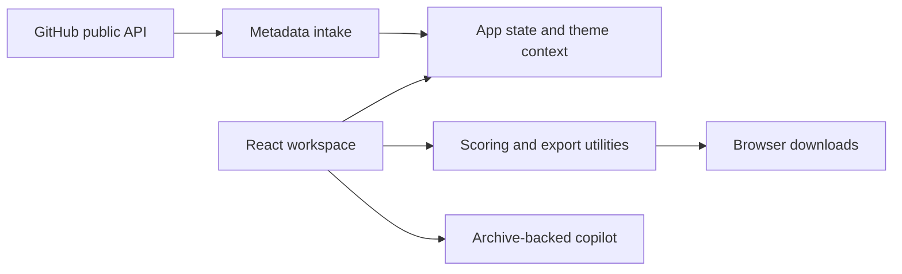

<div align="center">

# Project Graveyard

**Keep the context. Recover useful work. Decide what comes next.**

A browser-based workspace for revisiting unfinished software projects.

[](#technology)
[](#technology)
[](#implementation-scope)

[Product tour](#product-tour) &nbsp;&middot;&nbsp; [Quickstart](#quickstart) &nbsp;&middot;&nbsp; [Architecture](#architecture) &nbsp;&middot;&nbsp; [Project structure](#project-structure) &nbsp;&middot;&nbsp; [Team](#team)

<a href="docs/images/workspace.png"></a>

<sub>Current workspace with seeded demo data. Select the image to view it at full resolution.</sub>

</div>

## Overview

An unfinished project often contains useful code, a promising idea, and a forgotten set of decisions. Project Graveyard brings that context into one place so returning to a project does not have to mean starting over.

The workflow is simple: **preserve the project, evaluate what remains, then choose a focused next step.** You can revisit the reasons it stalled, inspect reusable modules, plan a two-hour restart, or keep it in the archive for later.

Built by **Team Hashing** for **Code Variant - Build 01, Round 2**, addressing **PS 05: The Project Graveyard**.

## Product tour

| Workspace | What you can do |
| --- | --- |
| **Project archive** | Browse and filter project records, inspect completion and revival scores, and remove records with confirmation. |
| **Project intake** | Add a project manually or request public GitHub repository metadata. Duplicate checks prevent matching titles or repository references from being added again. |
| **Autopsy view** | Review the recorded cause of abandonment, technical context, unfinished work, and curator notes. |
| **Revival Compass** | Explore a heuristic viability assessment, adjust selected inputs, and review a focused two-hour restart roadmap. |
| **Salvage Yard** | Inspect the supplied reusable modules, preview code, build a selection, and download an archive in the browser. |
| **Graft Studio** | Combine selected module records with a target project preset and inspect the scaffold and compatibility demo. |
| **Forensic copilot** | Ask about a selected project's recorded blockers, reusable work, technical context, or restart plan. |
| **Pattern Insights** | Explore the sample collection's abandonment categories and visual summaries. |

### A more focused project conversation

The copilot keeps the selected project visible, formats headings and lists, and offers a multiline composer with keyboard controls. Responses use the existing archive data; switching projects starts a fresh conversation. The floating robot retains its original animation.

<a href="docs/images/copilot.png"></a>

<sub>Select the preview to inspect the conversation interface.</sub>

### Try the core flow

1. Start the app and select **Sign In**. Use the prefilled demo form or choose a demo profile; the curator profile is **Aryan**.
2. Open **Archive at a glance**, then select **Review candidates** to filter projects with revival scores of 70 or higher.
3. Open a project's **Autopsy** or launch the floating assistant to explore its recorded context.
4. Use the header's **Add / New Project** control to try manual intake or the GitHub metadata demo.
5. Explore **Salvage Yard** and **Graft Studio** to inspect reusable module records and export options.

## Quickstart

### Requirements

- Node.js **22.12 or newer**. Local verification used Node.js **24.12.0**.
- npm and Git.
- A current browser. Clipboard actions require HTTPS or localhost; GitHub metadata and externally hosted images/fonts require network access.

```bash
git clone https://github.com/anshjaiswal2911-tech/Team-Hashing-CodeVariant.git
cd Team-Hashing-CodeVariant
npm ci --legacy-peer-deps
npm run dev
```

The development server starts on **http://localhost:3000**. If that port is occupied, use the next available URL printed by Vite.

The installation flag accommodates the repository's current Vite/esbuild peer-dependency mismatch. On Windows, use `npm.cmd` in place of `npm` if PowerShell blocks the npm script.

**No API key or database setup is required for the current demo.** The values in `.env.example` are scaffolding placeholders; the current frontend does not read `GEMINI_API_KEY` or `APP_URL`.

### Commands

| Command | Purpose |
| --- | --- |
| `npm run dev` | Start Vite on port 3000, with fallback to an available port. |
| `npm run lint` | Run TypeScript checking with `tsc --noEmit`; this is not an ESLint run. |
| `npm run build` | Generate the production frontend in `dist/`. |
| `npm run preview` | Serve the production build locally. Run the build command first. |

### Tests

The suites in [`tests/`](tests/) cover revival scoring, license classification, failure classification, archive-bound chat replies, and safe message formatting.

Vitest is not currently declared in `package.json`. Run the suites with an ephemeral runner, without changing the dependency manifest:

```bash
npm exec --yes --package=vitest@5.0.5 -- vitest run --globals
```

To check the production frontend:

```bash
npm run lint
npm run build
npm run preview
```

### Keyboard controls

| Shortcut | Action |
| --- | --- |
| `Ctrl + K` / `Cmd + K` | Open project and module search. |
| `J` | Open the quick-jump menu. |
| `N` / `B` | Open the new-project modal in the workspace. |
| `?` | Open the shortcut reference in the workspace. |
| `Esc` | Dismiss supported overlays or close a focused copilot window. |
| `Enter` / `Shift + Enter` | Send a copilot message / insert a new line. |

Global shortcuts are suppressed while typing in an input, textarea, or editable element, apart from Escape handling.

## Implementation scope

This repository is an interactive frontend prototype. The following distinctions matter when evaluating the demo or extending it.

| Area | Current behavior |
| --- | --- |
| **Authentication** | A simulated sign-in flow stores a local demo profile. It does not verify credentials against an identity provider. |
| **Project storage** | The active catalog, additions, deletions, and basket use React state. Refreshing the page restores the seeded collection. Theme, demo profile, and search history use browser storage. A storage hook exists but is not connected to the root catalog. Some dashboard totals are illustrative; the archive summary reflects the active collection. |
| **GitHub import** | Requests public repository metadata from GitHub's API. Failed requests can fall back to simulated metadata, and some zero-valued fields use demo defaults. The feature does not clone repositories or scan their source. |
| **Copilot** | Generates deterministic responses from the selected project's archive record. No remote LLM or Gemini request is made. |
| **Scoring and diagnostics** | Use local heuristics, sample records, and simulated checks. They are decision aids, not verified measures of security, compatibility, market demand, or deployment readiness. |
| **Code modernization** | Uses regular-expression transformations and illustrative reports. It is not an AST-based compiler and does not establish that the transformed code is correct or safe. |
| **Sharing and certificates** | Provides link/Markdown helpers and downloadable SVG certificates. Shared specimen URLs are not currently restored into a selected record on page load. Certificates are unsigned presentation artifacts. |

## Architecture

The application is a Vite-built React frontend. [`App.tsx`](src/App.tsx) owns screen navigation, the active project collection, and global overlays. Screens compose feature components; utilities handle local calculations and browser exports.



- **UI and state:** screen-based navigation, React hooks, and theme context; no server or database is needed to run the current frontend.
- **Project context:** typed records in `src/types/`, seeded from `src/data/` and passed into views, diagnostics, and the copilot.
- **Exports:** client-side generation of downloadable module bundles and presentation artifacts.
- **External requests:** public GitHub metadata plus remote fonts and images. The core seeded workflow does not depend on an AI API.

### Technology

| Concern | Implementation |
| --- | --- |
| UI | React 19 and TypeScript |
| Tooling | Vite 8 and the React Vite plugin |
| Styling | Tailwind CSS v4, CSS theme variables, and scoped copilot CSS |
| Icons | Lucide React and Material Symbols |
| Downloads | JSZip and browser file APIs |
| Audio and motion | Web Audio API and CSS animations |
| Testing | Vitest-compatible unit suites and browser verification |

## Project structure

```text
Team-Hashing-CodeVariant/
|-- docs/                         # Design notes, methodology, and project guides
|   `-- images/                   # Current README screenshots
|-- public/                       # Public static assets
|-- src/
|   |-- assets/                   # Bundled artwork, including the robot
|   |-- components/
|   |   |-- AiChatbot/            # Conversation UI, safe formatting, local replies
|   |   |-- Archive/              # Archive cards and collection summary
|   |   |-- Autopsy/              # Timeline, stack matrix, cause breakdown
|   |   |-- CommandPalette/       # Search and recent history
|   |   |-- Common/               # Empty states and celebration effects
|   |   |-- Graft/                # Donor cards and compatibility demo
|   |   |-- Insights/             # Abandonment visualizations
|   |   |-- Modals/               # Intake, autopsy, sharing, export, shortcuts
|   |   |-- Navigation/           # Header, sidebar, and quick jump
|   |   |-- Revival/              # Score cards and restart roadmap
|   |   |-- Salvage/              # Module filters, previews, dependency diagrams
|   |   `-- ui/                   # Shared UI primitives
|   |-- context/                  # Theme state and browser preference
|   |-- data/                     # Seeded projects, modules, and sample telemetry
|   |-- hooks/                    # Shortcuts, audio, storage, focus helpers
|   |-- types/                    # Shared project and module interfaces
|   |-- utils/                    # Scoring, classification, export, transformations
|   |-- views/                    # Landing, login, workspace, and feature screens
|   |-- App.tsx                   # Root state, navigation, global overlays
|   |-- index.css                 # Shared theme tokens and styles
|   `-- main.tsx                  # React entry point
|-- tests/                        # Unit suites
|-- .env.example                  # Optional scaffolding placeholders
|-- index.html                    # App shell and initial theme bootstrap
|-- package.json                  # Dependencies and application commands
|-- package-lock.json             # Locked dependency versions
|-- tsconfig.json                 # TypeScript configuration
`-- vite.config.ts                # React/Tailwind integration and dev settings
```

### Design references

These documents explain the product concept and intended design. Some describe a broader scope than the implemented prototype; use the runtime code and the scope table above to establish current behavior.

- [Problem statement](docs/PROBLEM_STATEMENT.md)
- [Architecture notes](docs/ARCHITECTURE.md)
- [Revival methodology](docs/REVIVAL_METHODOLOGY.md)
- [Forensics taxonomy](docs/forensics-taxonomy.md)
- [Salvage manifest specification](docs/salvage-manifest-spec.md)
- [Contribution guide](docs/CONTRIBUTING.md)

## Deployment

Build the frontend and configure a static host to serve the generated files:

| Setting | Value |
| --- | --- |
| Build command | `npm run build` |
| Publish directory | `dist` |
| Runtime | Static frontend; no application server required |

Automatic deployments depend on the hosting provider and repository configuration. This repository does not specify a verified public demo URL or a deployment pipeline.

## Team

| Member | Focus | GitHub |
| --- | --- | --- |
| Ansh Jaiswal | Team lead and frontend architecture | [anshjaiswal2911-tech](https://github.com/anshjaiswal2911-tech) |
| Aryan Jaiswal | UI/UX and design systems | [AryanJaiswalDev](https://github.com/AryanJaiswalDev) |
| Mitesh Jha | Logic, components, and integration | [jhamitesh0302-afk](https://github.com/jhamitesh0302-afk) |
| Rajiv Jha | Architecture, data, and documentation | [jharajiv315](https://github.com/jharajiv315) |

---

**Project Graveyard** &middot; A second look at unfinished work.
