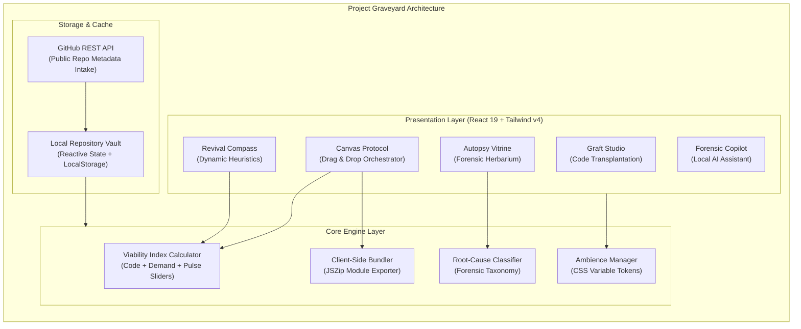

<div align="center">

# 🪦 Project Graveyard
### *Where Dead Projects Become Fertile Ground.*

**A Dignified Archival, Forensic Autopsy & Code Rebirth Engine for Modern Developers.**

[](https://github.com/anshjaiswal2911-tech/Team-Hashing-CodeVariant)
[](https://github.com/anshjaiswal2911-tech/Team-Hashing-CodeVariant)
[](https://react.dev/)
[](https://www.typescriptlang.org/)
[](https://tailwindcss.com/)
[](https://vitejs.dev/)

<br />

[Explore Canvas Protocol](#-the-canvas-protocol-interactive-workspace) &nbsp;&bull;&nbsp;
[Product Architecture](#-system-architecture) &nbsp;&bull;&nbsp;
[Core Capabilities](#-core-capabilities) &nbsp;&bull;&nbsp;
[Quickstart](#-quickstart-guide) &nbsp;&bull;&nbsp;
[Engineering Rigor](#-engineering-rigor--verification) &nbsp;&bull;&nbsp;
[The Team](#-built-by-team-hashing)

<br />

<a href="docs/images/hero-canvas.png">
  
</a>

<p align="center">
  <sub><strong>Figure 1.0:</strong> The <em>Canvas Protocol</em> in action — Dragging dormant repositories into Forensic AI Dropzones and instant Execution Zones.</sub>
</p>

</div>

---

## ⚡ Executive Summary & The Problem

Over **90% of software side-projects die silently in neglected local folders and private GitHub repositories**. Developers abandon them with feelings of guilt, loss of momentum, or context decay. Yet, within those abandoned codebases lie:
- ✅ **Tested, battle-hardened code modules** (*Auth flows, database schemas, custom hooks, API integrations*).
- ✅ **Unvalidated product ideas** whose market timing may finally have matured.
- ✅ **Invaluable technical lessons** that go unrecorded, causing developers to repeatedly trip over the same failure modes (*Scope Creep, Framework Fatigue, Abandoned Collaborations*).

**Project Graveyard** transforms this tragic graveyard into a **fertile innovation greenhouse**. Rather than letting code rot in digital shame, it gives repositories a **dignified burial**, extracts their reusable genetic material, computes a transparent **Revival Viability Index**, and cross-pollinates salvageable gems into new projects via our proprietary **Graft Studio**.

> *"Every dormant repository holds valuable engineering. We don't just mourn dead code — we harvest its seeds to birth the next generation of software."*

---

## 🌟 Visual Showcase & Key Modules

<table width="100%">
<tr>
<td width="50%" valign="top">
<h3 align="center">🧭 Revival Compass Diagnostic</h3>
<a href="docs/images/revival-compass.png">
  
</a>
<p align="center"><sub><strong>Figure 2.1:</strong> Multi-dimensional viability assessment: 3 core health signals, real-time developer momentum sliders, and actionable 2-hour sprint blueprints.</sub></p>
</td>
<td width="50%" valign="top">
<h3 align="center">🤖 Context-Aware AI Forensic Copilot</h3>
<a href="docs/images/copilot.png">
  
</a>
<p align="center"><sub><strong>Figure 2.2:</strong> Autonomous forensic agent auditing commit histories, identifying salvageable components, and diagnosing exact causes of failure.</sub></p>
</td>
</tr>
</table>

---

## 🎯 Core Capabilities

### 1. 🖐️ The Canvas Protocol (`Drag. Drop. Revive.`)
- **Spatial Tri-Column Workbench**: Replaces static CRUD dashboards with an interactive tactile canvas.
- **Drag-to-Diagnose**: Drag any project card from the left catalog and drop it into the central **AI Forensic Dropzone** to immediately compute its completion percentage, salvage potential, and cause of demise.
- **Instant Action Zones**: Drop staged specimens directly into right-side execution gates:
  - 🚀 **Deploy / Launch**: Launches a 120-minute revival sprint with focused scope pruning.
  - 🔬 **Submit / Publish**: Commences an in-depth forensic autopsy and issues a shareable digital folio.
  - 📦 **Save / Archive**: Preserves the specimen with honors in the Botanical Herbarium Vault.
  - 🗑️ **Delete / Remove**: Clean removal with safety guards.

### 2. 🪦 Dignified Burial Ceremony & Forensic Autopsy
- **Root-Cause Classification**: Automatically diagnoses why the project paused (*Circumstantial Scope Creep, Technical Debt, Lost Momentum, Solo Isolation*).
- **Herbarium Specimen Sheets**: Assigns museum-grade catalog folio numbers (e.g. `LL-02`, `EV-01`), botanical plates, and heartfelt developer epitaphs.
- **Legal & License Verification**: Identifies open-source compatibility to ensure salvaged code can be legally reused.

### 3. 🧭 Revival Compass & Decision Archetypes
- **3-Pillar High-Clarity Verdict**:
  1. 💻 **Code & Reusable Assets Built**: Preserved schema, auth, and tested UI.
  2. 💡 **Problem Relevance & Market Demand**: Verifies if the customer problem is still urgent today.
  3. ⏱️ **Effort to Ship MVP**: Clear 3-step path (*Prune scope &rarr; Re-link modern keys &rarr; Ship 1-feature MVP*).
- **Developer Pulse Check**: Real-time interactive calibration sliders (*Excitement*, *Skill Growth Since Burial*, *Solo vs. Team Overhead*) that dynamically recalculate the project's viability index.
- **5 Standard Archetypes**: Directs every codebase to its honest destiny:
  1. *Restart from Scratch* (Score &lt; 45)
  2. *Continue with a Smaller Scope* (Score 75–90)
  3. *Change the Core Idea* (Score 60–74)
  4. *Repurpose Component Gems Only* (Score 45–59)
  5. *Honor & Archive in Deep Soil* (Score &lt; 35)

### 4. 📦 Salvage Yard & Code Harvester
- **Modular Extraction**: Dissects monolithic dead repos into isolated, production-ready modules (*Auth Systems, Stripe Checkouts, UI Kits, Custom Hooks*).
- **1-Click Client-Side Export**: Generates and downloads real `.zip` bundles directly in the browser using `JSZip` — no remote server latency or data leakage.

### 5. 🌱 Graft Studio (Code Cross-Pollination)
- **Botanical Grafting Engine**: Takes harvested modules from Project A and grafts them into a fresh starter scaffold (Next.js, Vite React, Svelte, or Remix).
- **Dependency & Compatibility Check**: Evaluates runtime version gaps before code transplantation.

### 6. 📊 Pattern Insights (The Developer's Mirror)
- **Macro Retrospective**: Surfaces overarching habits across your graveyard.
- **Failure Analytics**: Visual breakdown of why your past 20 projects died so you never repeat the same mistakes in future sprints.

### 7. 🎨 Ambient Theming System
- **5 Curated Designer Themes**:
  - 🌿 **Botanical Ivory (Pitch Deck Edition)**: Warm ivory canvas with deep pine forest typography.
  - 🧊 **Neo-Tactile Soft UI (Pivora Kit)**: Calm sand textures with sunken wells and raised cream tactile buttons.
  - 🌌 **Galactic Glass (Dark Glassmorphism)**: Smoky emerald glass over an obsidian deep void.
  - 🌙 **Botanical Dark (Original Conservatory)**: Midnight forest depths with sage accents.
  - ☀️ **Monochrome SaaS (Enterprise Minimal)**: High-contrast luxury black and white.

---

## 🏗️ System Architecture

Project Graveyard is engineered as a **100% client-driven, zero-latency progressive web application**. It requires no heavy database cold-starts or expensive third-party infrastructure to experience full functionality.



---

## 💻 Tech Stack & Engineering Rigor

| Layer | Technology | Engineering Rationale |
| :--- | :--- | :--- |
| **Frontend Framework** | **React 19** | Latest React architecture utilizing automatic compiler optimizations and modern hooks. |
| **Language** | **TypeScript 5 (Strict)** | Comprehensive typed contracts across specimens, modules, telemetry, and forensic diagnoses. |
| **Styling & Design Tokens** | **Tailwind CSS v4** | Next-generation zero-config CSS engine with high-performance CSS theme variable tokens. |
| **Build Tooling** | **Vite 8** | Sub-400ms production builds and instant Hot Module Replacement (HMR). |
| **Iconography** | **Lucide React + Material Symbols** | Consistent botanical, mechanical, and developer symbols with accessible SVGs. |
| **Client-Side Export** | **JSZip** | Compiles real file system directory trees in browser memory for instant download. |
| **Haptic & Sound Design** | **Web Audio API** | Subtle synthesized acoustic feedback for card drops, sprigs, and burial ceremonies. |

---

## ⌨️ Productivity Keyboard Shortcuts

For power developers and hackathon judges, Project Graveyard features built-in global shortcuts:

| Shortcut | Action | Scope |
| :---: | :--- | :--- |
| <kbd>Cmd</kbd> + <kbd>K</kbd> / <kbd>Ctrl</kbd> + <kbd>K</kbd> | Open Global Command Palette & Specimen Search | App-wide |
| <kbd>J</kbd> | Quick-Jump to Workspace Views | Workspace |
| <kbd>N</kbd> or <kbd>B</kbd> | Open "Bury a Project / Add Specimen" Modal | Workspace |
| <kbd>?</kbd> | View Interactive Keyboard Shortcuts Reference | App-wide |
| <kbd>Esc</kbd> | Dismiss any open modal, drawer, or theme menu | Global |
| <kbd>Enter</kbd> / <kbd>Shift + Enter</kbd> | Send Copilot message / Insert multiline code | AI Copilot |

---

## 🚀 Quickstart Guide

### Prerequisites
- **Node.js**: `v22.12` or newer (Tested cleanly on Node `v22.22.1` & `v24.12.0`).
- **npm**: `v10+` and Git.

### Installation & Local Run

```bash
# 1. Clone the repository
git clone https://github.com/anshjaiswal2911-tech/Team-Hashing-CodeVariant.git
cd Team-Hashing-CodeVariant

# 2. Install dependencies (peer-dependency clean)
npm ci --legacy-peer-deps

# 3. Start high-speed local dev server
npm run dev
```

Open your browser to **`http://localhost:3000`** (or next available port).

### Production Build & Verification

```bash
# Verify TypeScript typing with zero errors
npm run lint

# Generate production bundle in dist/
npm run build

# Preview production build locally
npm run preview
```

---

## 🧪 Testing & Verification

Unit test suites cover viability algorithms, module licensing extraction, failure mode classification, and archive message sanitization:

```bash
# Run Vitest test suites
npm exec --yes --package=vitest@5.0.5 -- vitest run --globals
```

---

## 👥 Built by Team Hashing

Developed with pride for **Code Variant Hackathon — Build 01 (Round 2)** addressing **Problem Statement 05: The Project Graveyard**.

<div align="center">

| Member | Focus | GitHub Profile |
| :--- | :--- | :---: |
| **Ansh Jaiswal** | **Team Lead & Frontend Architecture** | [@anshjaiswal2911-tech](https://github.com/anshjaiswal2911-tech) |
| **Aryan Jaiswal** | **UI/UX, Ambience Themes & Design Systems** | [@AryanJaiswalDev](https://github.com/AryanJaiswalDev) |
| **Mitesh Jha** | **Canvas Protocol, Drag-Drop Logic & Integration** | [@jhamitesh0302-afk](https://github.com/jhamitesh0302-afk) |
| **Rajiv Jha** | **Forensics Methodology, Data Schemas & Architecture** | [@jharajiv315](https://github.com/jharajiv315) |

<br />

<p align="center">
  <sub>Project Graveyard &copy; 2026 Team Hashing. Distributed under the MIT License.</sub>
</p>

</div>
